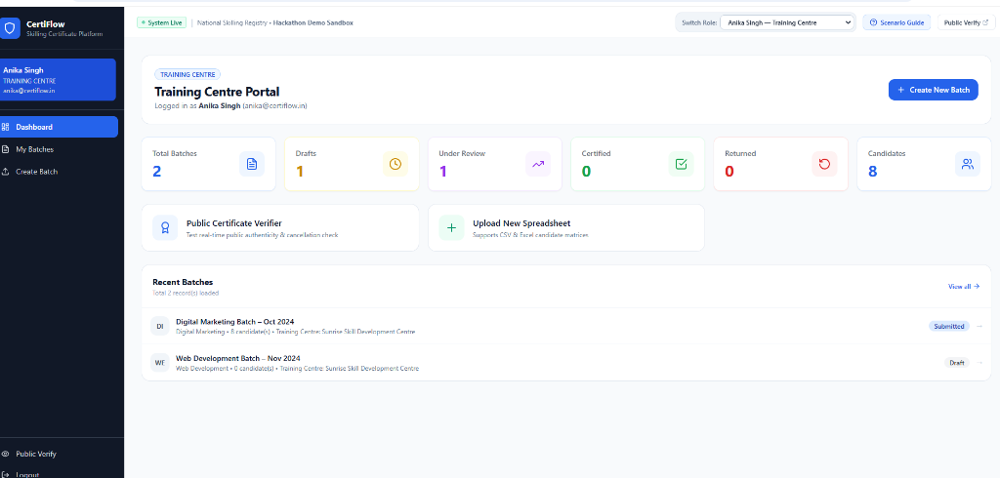
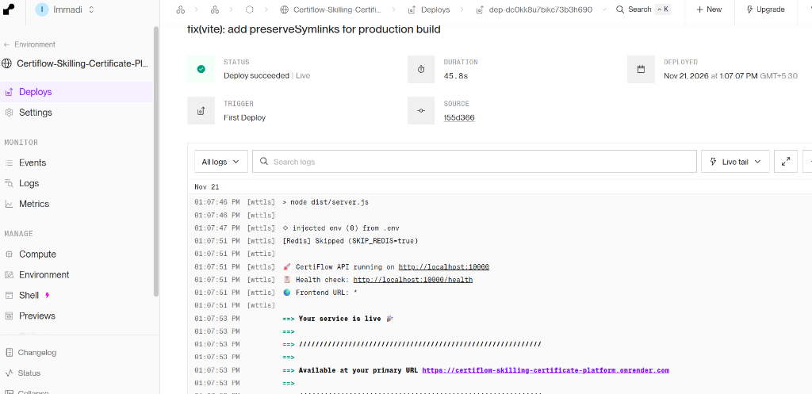
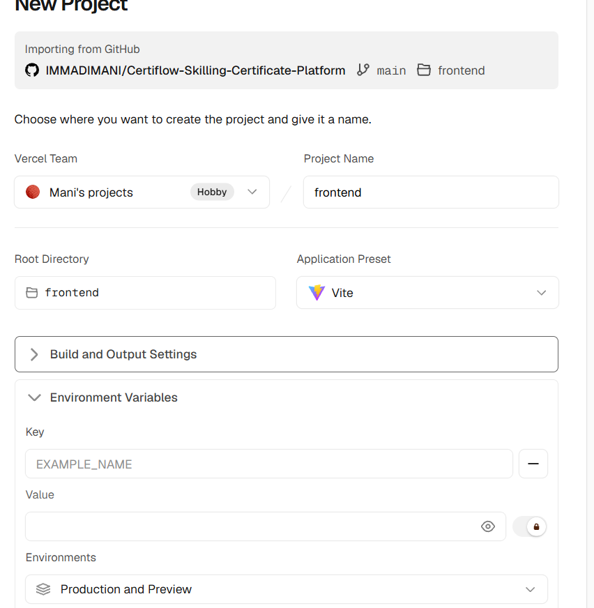
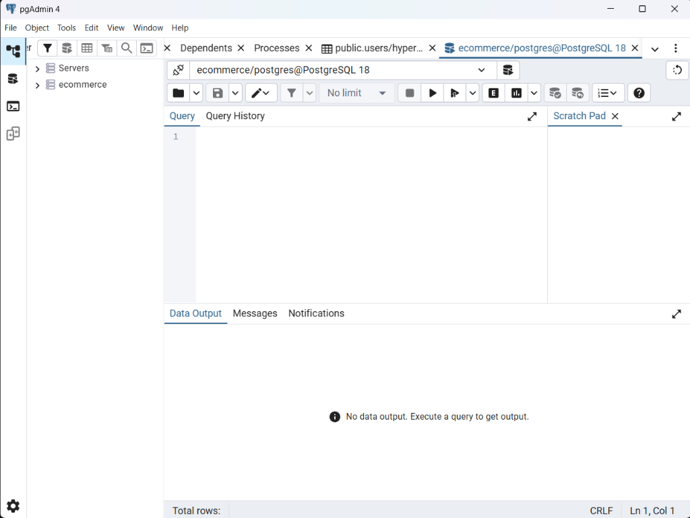

# CertiFlow — Skilling Certificate Issuance & Verification Platform

<div align="center">



**A Centralized Digital Governance Platform for Skilling Certification Life-Cycle**  
*Automated Spreadsheet Validation • Dual District Officer Consensus • High-Volume Quality Scrutiny • Verifiable QR PDF Credentials • Instant Public Authenticity Portal*

[](https://certiflow-skilling-platform.vercel.app)
[](https://certiflow-skilling-certificate-platform.onrender.com)
[](https://neon.tech)
[](https://www.typescriptlang.org)
[](https://react.dev)

### 🌐 [Live Production App](https://certiflow-skilling-platform.vercel.app) &nbsp;|&nbsp; 🔍 [Public Certificate Verifier](https://certiflow-skilling-platform.vercel.app/verify) &nbsp;|&nbsp; 📄 [Download Official Submission Dossier (PDF)](./CertiFlow_Illustrated_Final_Submission_Dossier.pdf)

</div>

---

## 🎯 Executive Summary & Problem Context

Legacy skill certification workflows rely on physical paper forms or unsecured spreadsheets emailed to district offices. District officers perform manual inspection without dual-governance cross-checks, certificates are forged easily, and verification takes weeks.

**CertiFlow** delivers an end-to-end digital governance architecture:
1. **Atomic Spreadsheet Ingestion:** Row-by-row regex schema validation with zero-partial-save transaction rollbacks.
2. **Dual-Officer District Consensus:** Requires two distinct district officers to agree before any batch advances.
3. **High-Volume Quality Assurance Trigger:** Batches with $\ge 50$ candidates route automatically to the State Quality Assurance board.
4. **Tamper-Proof Credential Issuance:** Cryptographically generated PDF certificates embedding verifiable smartphone QR codes.
5. **Real-time Certificate Revocation:** Revoked credentials immediately reflect as **CANCELLED** in red on the public registry.
6. **Immutable Audit Logging:** Write-once, tamper-proof event logging tracking every administrative decision.

---

## 👥 Reviewer & Judge Demo Accounts

To test the entire governance workflow without typing credentials, reviewers can use the **1-Click Demo Login cards** on the login page or the **"Switch Role"** dropdown in the top header:

| Role | Officer Name | Email | Password | Governance Responsibility |
|---|---|---|---|---|
| **Training Centre** | Anika Singh | `anika@certiflow.in` | `password123` | Batch creation, CSV uploads, error corrections |
| **District Officer (North)** | Dev Sharma | `dev@certiflow.in` | `password123` | District approval 1 of 2 |
| **District Officer (South)** | Meera Patel | `meera@certiflow.in` | `password123` | District approval 2 of 2 |
| **District Officer (East)** | Kabir Khan | `kabir@certiflow.in` | `password123` | Alternate District Officer |
| **Quality Team** | Neha Gupta | `neha@certiflow.in` | `password123` | Mandatory scrutiny on batches $\ge 50$ candidates |
| **State Office** | Farah Irani | `farah@certiflow.in` | `password123` | Final authorization, certificate issuance & revocation |
| **Public Verifier** | Anyone | *No login needed* | *No login needed* | Authenticate credentials via `/verify` or QR scan |

---

## 🔄 End-to-End Governance Lifecycle

```
┌─────────────────────────┐
│     Training Centre     │ ──> Uploads spreadsheet (sample_60_candidates.csv)
│      (Anika Singh)      │ <── Corrects & resubmits if returned
└───────────┬─────────────┘
            │ Strict Schema Validation (Atomicity Guarantee)
            ▼
┌─────────────────────────┐
│   District Officer 1    │ ──> Reviews candidate details & records Decision 1/2
│      (Dev Sharma)       │
└───────────┬─────────────┘
            │ Status: UNDER_REVIEW
            ▼
┌─────────────────────────┐
│   District Officer 2    │ ──> Records Decision 2/2 (Consensus Required)
│      (Meera Patel)      │
└───────────┬─────────────┘
            │
    ┌───────┴───────────────────────────────┐
    ▼ [If Batch < 50 Candidates]            ▼ [If Batch >= 50 Candidates]
┌─────────────────────────┐     ┌─────────────────────────┐
│      State Office       │     │      Quality Team       │ ──> Inspects curriculum, attendance
│      (Farah Irani)      │     │      (Neha Gupta)       │     & exam marks
└───────────┬─────────────┘     └───────────┬─────────────┘
            │                               │ Status: QUALITY_REVIEW
            │                               ▼
            └──────────────────────> ┌─────────────────────────┐
                                     │   State Final Review    │ ──> Final authorization
                                     │      (Farah Irani)      │
                                     └───────────┬─────────────┘
                                                 ▼
                                     ┌─────────────────────────┐
                                     │ Certificate Generation  │ ──> 60 Unique PDF Certificates
                                     │       & QR Codes        │ ──> WhatsApp Notifications (Simulated)
                                     └───────────┬─────────────┘
                                                 ▼
                                     ┌─────────────────────────┐
                                     │   Public Verification   │ ──> Zero-login instant check
                                     │  (Employers & Citizens) │ ──> Live Cancellation Flagging
                                     └─────────────────────────┘
```

---

## 🧪 Proof of the Six Mandatory Hackathon Scenarios

### Scenario 1: Invalid Spreadsheet Validation (Zero-Partial-Save)
* **Test File:** `backend/samples/sample_invalid_rows.csv`
* **Result:** System flags 6 validation errors with exact row numbers (e.g. Row 2: Candidate name required, Row 2: Father name required, Row 4: Invalid phone).
* **Atomicity:** Complete transaction rollback ensures **0 corrupt records** are written to PostgreSQL.

### Scenario 2: Simultaneous Dual District Officer Approval
* **Implementation:** `prisma.$transaction()` with unique constraint `@@unique([batchId, officerId])`.
* **Result:** Dev Sharma records the first approval (Status: `UNDER_REVIEW`, 1/2). Meera Patel records the second approval. Batch advances only when 2 distinct officers agree.

### Scenario 3: 60 Candidates & Large Batch Quality Review
* **Test File:** `backend/samples/sample_60_candidates.csv`
* **Result:** Automatically triggers the $\ge 50$ threshold. Routed to Neha Gupta for Quality Assurance. Following State final approval, generates exactly 60 unique verifiable certificates without duplicates.

### Scenario 4: Certificate Revocation & Public Verification
* **Action:** State Office revokes an issued certificate with an audit reason.
* **Result:** Searching the certificate number on `/verify` immediately renders a red warning banner: **"❌ Certificate is Cancelled"** with the cancellation timestamp and reason.

### Scenario 5: Delayed Officer Approval SLA Detection
* **Detection:** Automated query detects batches where `submittedAt < now() - 48 hours`.
* **Result:** Overdue warning badges trigger across District and State dashboards for administrative escalation.

### Scenario 6: Batch Return, Correction & Resubmission
* **Workflow:** An officer returns a batch with specific remarks. Status changes to `RETURNED`. The training centre updates candidate details and resubmits. Prior votes reset, while the complete history is permanently preserved in the immutable `AuditLog` table.

---

## ☁️ Cloud Architecture & Infrastructure Proof

### Live Backend API (Render)

*Automated Prisma database migrations and server initialization over HTTPS.*

### Live Global Frontend CDN (Vercel)

*Vercel deployment linking React frontend to the Render Cloud API via `VITE_API_URL`.*

### Relational Database Architecture (PostgreSQL on Neon)

*PostgreSQL schema enforcing foreign key relations, unique indices, and append-only audit trails.*

---

## 🛠️ Tech Stack & Directory Structure

```
certiflow/
├── frontend/                          # React + Vite + TypeScript
│   ├── src/
│   │   ├── components/layout/         # GovTech Layout, Enterprise Header, Sidebar
│   │   ├── context/                   # AuthContext with 1-Click Role Switcher
│   │   ├── pages/                     # Role dashboards, Batches, Approvals, Verify
│   │   └── services/api.ts            # Centralized Axios client
│   ├── vercel.json                    # Single Page App routing configuration
│   └── tailwind.config.js             # Styling tokens
├── backend/                           # Node.js + Express + TypeScript
│   ├── src/
│   │   ├── modules/                   # auth, batches, approvals, quality, state, certs
│   │   ├── config/                    # database (Prisma) and redis clients
│   │   ├── utils/                     # Row validators, database seed script
│   │   └── server.ts                  # Express app, Socket.IO, static endpoints
│   ├── prisma/schema.prisma           # Relational schema definition
│   └── samples/                       # sample_60_candidates.csv, sample_invalid_rows.csv
├── docs/images/                       # Architectural & UI screenshots
├── CertiFlow_Illustrated_Final_Submission_Dossier.pdf # Official 5-page submission dossier
├── docker-compose.yml                 # Multi-container local orchestration
├── README.md
├── SETUP.md
└── DEPLOYMENT.md
```

---

## 🚀 Local Quickstart (Run with 1 Command)

### Prerequisites:
* Node.js v18+ & npm
* PostgreSQL 16 (Local or Neon connection string)

```powershell
# 1. Clone repository
git clone https://github.com/IMMADIMANI/Certiflow-Skilling-Certificate-Platform.git
cd Certiflow-Skilling-Certificate-Platform

# 2. Setup backend
cd backend
npm install
npx prisma db push
npm run db:seed
npm run dev

# 3. Setup frontend (in a new terminal tab)
cd ../frontend
npm install
npm run dev
```

Open `http://localhost:5173` and click on any demo card to start evaluating!

---

## 📄 License & Hackathon Declaration

Developed by **Immadi Mani** for the Skilling Certificate Issuance Platform Hackathon.  
Distributed under the **MIT License**. Free for evaluation and demonstration purposes.
